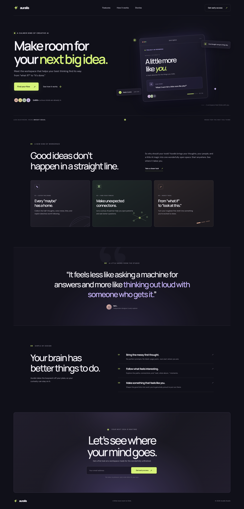

# Auralis

A polished, responsive landing page for Auralis, a fictional creative workspace. Built with plain HTML, CSS, and JavaScript—no build step or framework required.

## Preview



## Run locally

Open `index.html` directly in a browser, or serve this folder with any static file server. For example, with Python installed:

```bash
python -m http.server 8000
```

Then visit <http://localhost:8000>.

## Files

- `index.html` — page structure and content
- `styles.css` — responsive layout, typography, and visual styling
- `script.js` — mobile navigation, signup form feedback, and current year
- `screenshot.png` — full-page desktop preview

The email signup is a front-end demo and does not submit data to a backend.
